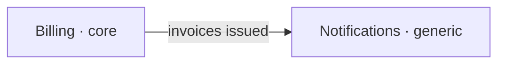

<!-- Written by GYOS /gyos:discover on <date>. A draft model, not a specification. -->

# Context map: <product>

## Overview

<One line per arrow: upstream → downstream, and the relationship pattern.>

## Contexts

### <context-name>

- **Purpose:** <two sentences, business language only>
- **Classification:** <core | supporting | generic> · <revenue | engagement | compliance> ·
  <genesis | custom built | product | commodity>
- **Modelling depth:** <rich domain model | simple CRUD | bought, behind a port>
- **Domain roles:** <for example: execution, analysis, gateway>
- **Inbound:** <commands, queries and events it receives, and from whom>
- **Outbound:** <commands, queries and events it sends, and to whom>
- **Ubiquitous language:** <the key terms; the full glossary is `.claude/skills/<context-name>/glossary.md`>
- **Business decisions:**
  - <a rule or policy, confirmed by the user>
- **Invariants:**
  - <what must never happen, and the trap it avoids>
- **Examples:**
  - <Given … When … Then …, with real values; `/gyos:init` turns these into .feature files>
- **Assumptions:**
  - <inferred | speculative>: <…>
- **Verification metrics:** <how you'd know this context is doing its job>
- **Open questions:**
  - [ ] <…>

## Relationships

| Upstream | Downstream | Pattern | In code |
| --- | --- | --- | --- |
| <context> | <context> | <open host service · anticorruption layer · conformist · …> | <port in the downstream module, implemented by the host · direct import · published view> |

## Junctions

Rules that span two contexts. Each belongs to neither, and its owner is settled once.

| Junction | Contexts | Owner | Reasons |
| --- | --- | --- | --- |
| <"when X completes in A, do Y in B"> | <A, B> | <the host's composition root, or …> | <link to the ADR, once written> |

## Open questions across contexts

- [ ] <…>
