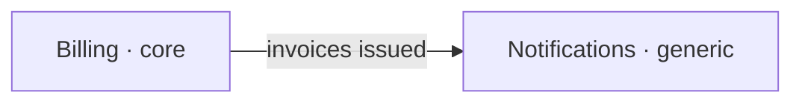

<!-- Written by GYOS <version> /gyos:discover on <date>. A draft model, not a specification. -->

# Context map: <product>

## Overview

<One line per arrow: upstream → downstream, and the relationship pattern.>

## Contexts

A field the interview didn't cover holds `—` or an open question, never a filler.

### <context-name>

- **Purpose:** <two sentences, business language only>
- **Classification:** <core | supporting | generic> · <revenue | engagement | compliance> ·
  <genesis | custom built | product | commodity>
- **Modelling depth:** <rich domain model | simple CRUD | bought, behind a port>
- **Domain roles:** <for example: execution, analysis, gateway>
- **Inbound:** <commands, queries and events it receives, and from whom>
- **Outbound:** <commands, queries and events it sends, and to whom>
- **Glossary (draft):** `/gyos:init` moves it into the context's skill, adds the code names, and
  replaces it here with a link.

  | Term (business language) | Meaning here | Banned synonyms |
  | --- | --- | --- |
  | <term> | <…> | <…> |

- **Business decisions:**
  - <a rule or policy, confirmed by the user>
- **Invariants:**
  - <what must never happen, and the trap it avoids>
- **Examples:**
  - <Given … When … Then …, with real values. `/gyos:init` moves these into the skill's
    scenarios.md as promises not built yet>
- **Assumptions:**
  - <inferred | speculative>: <…>
- **Verification metrics:** <how you'd know this context is doing its job>
- **Open questions:**
  - [ ] <…>

## Relationships

| Upstream | Downstream | Pattern | In code |
| --- | --- | --- | --- |
| <context> | <context> | <open host service · anticorruption layer · conformist · …> | <port in the downstream module, implemented by the host · direct import · published view> |

## Junctions

Rules that span two contexts. Each belongs to neither, and its owner is settled once.

| Junction | Contexts | Owner | Reason | ADR |
| --- | --- | --- | --- | --- |
| <"when X completes in A, do Y in B"> | <A, B> | <the host's composition root, or …> | <one line> | <written by `/gyos:init`> |

## Open questions across contexts

- [ ] <…>
